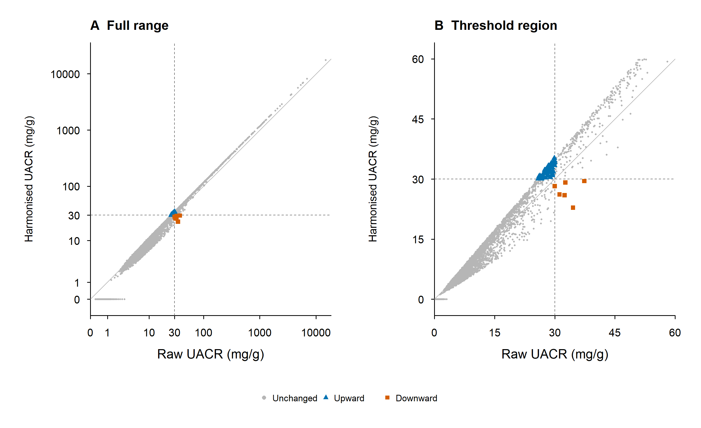
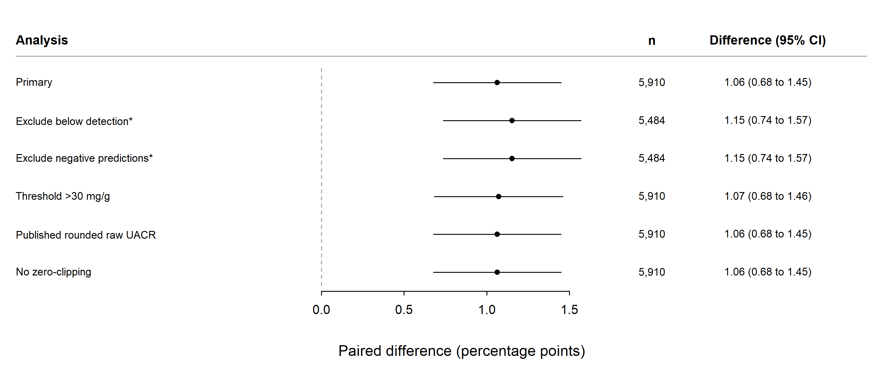
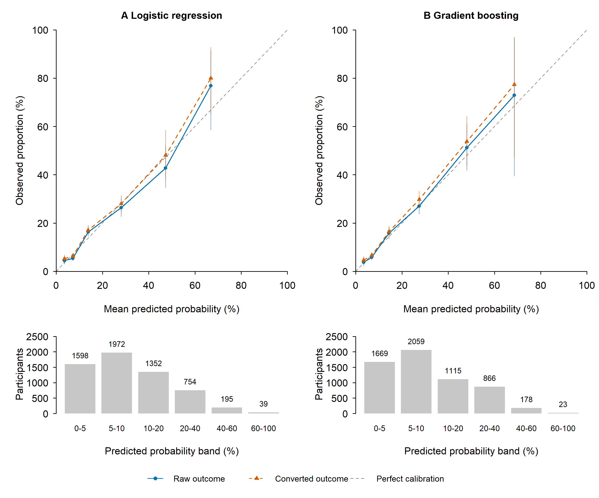

# Urine albumin assay harmonisation in NHANES

This report brings together the paired survey analysis, sensitivity checks and exploratory modelling extension. The analysis developed after inspection of pilot results and was not prospectively preregistered.

## Introduction

NHANES changed its urine albumin measurement method for August 2021–August 2023. CDC provides a bridging equation to express results on the earlier assay scale.[1](#ref1) Because UACR classification depends on a fixed threshold, converting albumin may change the estimated proportion of adults above that threshold. We quantified this effect within the same survey participants and examined its sensitivity to analytical choices and missing urine results. A related modelling analysis examined whether changing the assay definition also changes the evaluation of predictions made from non-urine characteristics. The outcome was single-specimen UACR ≥30 mg/g; it was not a diagnosis of CKD, which requires evidence of chronicity.[6](#ref6)

## Methods

We examined how converting urine albumin to an earlier assay scale changed the estimated proportion of adults with a single-specimen urine albumin-to-creatinine ratio (UACR) of at least 30 mg/g in NHANES August 2021–August 2023. This was a paired comparison of two calculations for the same participants. It did not assess trends between survey cycles or diagnose persistent albuminuria or chronic kidney disease (CKD).

Demographic and laboratory records were joined one-to-one using participant identifier SEQN in SQLite. SQL views defined eligibility, UACR and assay-converted classifications; SQL queries also produced cohort-flow, reclassification and demographic missingness summaries. Python decoded the XPT inputs and performed survey estimation. Of 7,809 adults aged 20 years or older, 6,064 had a positive, finite examination weight (WTMEC2YR). Complete urine data required finite, nonnegative albumin and finite, strictly positive creatinine. The analysis included 5,910 adults; 154 examined adults lacked both analytes. Examination eligibility was checked against RIDSTATR.[2](#ref2) The loader restored the exact XPORT zero sentinel produced by the Python reader to zero before checking weights and detection flags.

Urine albumin (URXUMA) was measured in µg/mL and urine creatinine (URXUCR) in mg/dL. We calculated raw UACR as 100 × URXUMA / URXUCR, in mg/g. CDC's backward weighted Deming equation, based on a 195-specimen bridging study, mapped albumin to the earlier assay scale:[1](#ref1)

`converted albumin = −1.643 + 1.189 × URXUMA`.

Creatinine was unchanged. Negative converted albumin values were set to zero, an analysis convention. Released below-detection values were retained without further imputation, using URDUMALC and URDUCRLC to identify detection status.[1](#ref1) Missing urine results were not replaced. UACR was not rounded before applying the inclusive threshold of ≥30 mg/g.

We used WTMEC2YR, strata SDMVSTRA and nested primary sampling units SDMVPSU. All 8,860 participants with positive, finite examination weights remained in the survey design, including children and adults without urine results. Complete-data adults formed the analysis domain. The design contained 15 strata and 30 primary sampling units, giving 15 design degrees of freedom. Estimates were weighted domain means. The paired change was calculated directly from each participant's converted classification minus their raw classification. Variances used with-replacement Taylor linearisation without a finite population correction; 95% confidence intervals used the t distribution with 15 degrees of freedom. This survey-design approach follows CDC guidance on domain analysis and variance estimation.[3](#ref3) Proportions are reported as percentages and changes as percentage points.

The primary analysis used complete urine cases and released examination weights, without additional urine item nonresponse adjustment. Sensitivities excluded below-detection observations or negative converted values, omitted zero-clipping, used a strict >30 mg/g threshold, or used published rounded raw UACR (URDACT). Additional response weighting used 36 age-group × sex × race/ethnicity cells, assuming exchangeability within cells; its intervals treated the examined-adult target totals as fixed. Worst-case paired-change bounds allowed the mean classification change among adults with missing urine results to range from −1 to +1. These are identification bounds, not confidence intervals.

Separate R and Python implementations read the original XPT files and reconstructed the analysis; the R implementation used the survey package (version 4.5).[4](#ref4) Saved validation records report agreement for 216 numeric comparisons across the primary analysis and five sensitivities, with seven unweighted count checks also passing. This checks implementation under shared assumptions; it does not validate the assay bridge or establish that nonresponse is ignorable. A supplementary research reliability screen used Korn–Graubard intervals for proportions, following the NCHS framework.[5](#ref5) This framework was not applied to the paired difference, which is not a binomial proportion. All sampling intervals treated the assay conversion coefficients as fixed and excluded uncertainty in those coefficients.

### Exploratory modelling

The modelling extension used seven predictors: age, recorded sex, BMI, mean systolic and diastolic blood pressure, diabetes history and smoking status. SQL left joins added examination and questionnaire records to the same 5,910 complete-urine adults. Missing predictor values did not remove participants. Urine measurements, UACR and their derived flags were excluded from the predictors. The target was elevated UACR at the same examination, rather than future disease.

We compared a training-fold prevalence baseline, regularised logistic regression and histogram gradient boosting. Model settings were fixed before the first fit. Five-fold validation kept each public-use stratum/PSU group together, with each participant receiving one prediction from a model trained without that group. Numeric imputation, missingness indicators, scaling and categorical encoding were fitted within training folds. Model fitting used MEC weights scaled to mean one; evaluation used the original weights. Detailed settings, variable coding and source codebooks are given in the [ML analysis plan](../docs/ml_analysis_plan.md).

Models were trained against raw classifications. The same held-out probabilities were then evaluated against raw and converted classifications using weighted ROC-AUC, average precision, Brier score and log loss. Unweighted metrics were retained as a sensitivity analysis. Calibration compared weighted mean predictions with observed proportions in six fixed probability bands. The overall calibration gap was mean prediction minus observed prevalence.

A follow-up retained the model settings and used logistic regression as the primary model for interpretation. Five fixed split seeds assessed sensitivity to fold assignment; their ranges are not confidence intervals. A separate analysis used 1,000 within-stratum PSU resamples while holding the seed-42 predictions fixed. The resulting percentile intervals describe uncertainty conditional on those predictions, excluding model-refitting uncertainty and dependence from overlapping training sets. They are not full confidence intervals for the modelling procedure. The [validation methods](../docs/ml_validation_methods.md) give the resampling assumptions and references.

## Results

Primary estimates are summarised in Table 1. Participant-level classification changes are shown in Figure 1; sensitivity estimates are shown in Figure 2.

Among examined adults, 154 of 6,064 (2.54% unweighted; 2.60% examination-weighted) lacked usable urine results. The complete-data analysis included 5,910 adults.

**Table 1. Survey-weighted primary results among 5,910 complete-data adults.**

| Outcome | Weighted estimate | Sampling 95% confidence interval |
|---|---:|---:|
| Raw UACR ≥30 mg/g | 10.35% | 9.36–11.35% |
| Converted UACR ≥30 mg/g | 11.42% | 10.25–12.59% |
| Paired change, converted minus raw | +1.06 percentage points | +0.68 to +1.45 percentage points |
| Any classification change | 1.23% | 0.85–1.61% |

The unweighted number above the threshold increased from 721 to 786. There were 77 classification changes: 71 upward and six downward. These participant counts differ from the weighted population percentages. The downward group was sparse, with six events across six primary sampling units. Its weighted estimate was 0.084%, with a supplementary Korn–Graubard 95% interval of 0.027–0.197%. Although it passed the reporting reliability screen, the small event count limits subgroup interpretation.

Additional demographic response weighting gave a paired increase of 1.066 percentage points, compared with 1.063 before adjustment. Although this adjustment changed the estimate little, it cannot resolve nonignorable missingness. Unrestricted missing-group assignments gave all-examined-adult paired-change bounds of −1.57 to +3.64 percentage points. These bounds cross zero, are not confidence intervals, and do not imply that the extreme assignments are likely.

Excluding below-detection observations or negative converted albumin values reduced the domain to 5,484 adults and gave a paired increase of 1.153 percentage points (95% CI 0.737–1.570). Omitting zero-clipping left threshold classifications unchanged. Using >30 mg/g gave an increase of 1.072 percentage points (95% CI 0.683–1.461); using published rounded raw UACR gave 1.063 percentage points (95% CI 0.677–1.450).

The observed complete-data paired increase therefore depends on the stated assay conversion and missing-data assumptions. Its sampling confidence interval does not cover assay-bridge uncertainty or missing-data bias. A single urine measurement does not establish CKD.[6](#ref6)

### Predictive performance and calibration

Both fitted models had lower Brier scores than the prevalence baseline in the initial grouped validation (Table 2). ROC-AUC was lower when the same predictions were evaluated against converted labels. Average precision increased, but this metric also depends on prevalence; its increase alone does not establish improved ranking.

**Table 2. MEC-weighted performance of the same held-out predictions under both assay definitions.**

| Model | Assay definition | ROC-AUC | Average precision | Brier score |
|---|---|---:|---:|---:|
| Prevalence baseline | Raw | 0.463 | 0.096 | 0.0929 |
| Prevalence baseline | Converted | 0.458 | 0.105 | 0.1014 |
| Logistic regression | Raw | 0.741 | 0.315 | 0.0827 |
| Logistic regression | Converted | 0.729 | 0.333 | 0.0900 |
| Gradient boosting | Raw | 0.762 | 0.321 | 0.0817 |
| Gradient boosting | Converted | 0.749 | 0.337 | 0.0891 |

The baseline used the weighted prevalence in each training fold. Its predictions therefore varied between folds, so its pooled ROC-AUC need not equal 0.5. These are internal-validation point estimates, not externally validated performance measures.

For logistic regression, the overall prediction-minus-observation gap was +0.05 percentage points against raw labels and −1.02 against converted labels. Corresponding conditional intervals were −0.72 to +0.69 and −1.92 to −0.24 percentage points. Gradient boosting gave gaps of −0.08 and −1.14 percentage points. Figure 3 shows that overall agreement did not imply calibration within every probability band. The highest band contained only 39 participants for logistic regression and 23 for gradient boosting.

Across five split seeds, raw-label ROC-AUC ranged from 0.740 to 0.744 for logistic regression and from 0.761 to 0.765 for gradient boosting. Converted-label ranges were 0.728–0.733 and 0.749–0.753, respectively. These narrow ranges describe the splits tested, not uncertainty in a new population. Complete metrics, paired contrasts and conditional intervals are reported in the [ML validation report](ml_validation.md).

## Discussion

Converting urine albumin to the earlier assay scale increased the estimated proportion of adults with UACR ≥30 mg/g from 10.35% to 11.42%. The paired increase was 1.06 percentage points (95% CI 0.68–1.45). Most participants kept the same classification, but 1.23% crossed the threshold. This shows that the choice of assay scale affected the estimate even though the participants and their urine samples were unchanged.

The main implication concerns how survey estimates are compared. In this analysis, applying the conversion equation was enough to change the proportion above a commonly used threshold. Assay differences therefore need attention before estimates from different survey cycles are interpreted as changes in population health. We have only examined the effect of the conversion within August 2021–August 2023. We have not estimated a trend across cycles or established which assay scale better represents underlying kidney health.

There were 71 upward crossings and six downward crossings. The downward changes are consistent with the form of the conversion equation: its negative intercept means that it can lower albumin at low concentrations, while its slope can raise albumin at higher concentrations. The conversion does not increase every result by the same amount. However, six downward events provide little basis for describing who is more likely to move in that direction. We have retained the count and uncertainty interval without drawing subgroup conclusions.

The paired design is a strength because each participant contributes both classifications. Calculating the change within people also accounts for the relationship between the two estimates. The analysis retained the survey strata and sampling units when estimating uncertainty. Separate R and Python implementations agreed, which gives confidence that the calculations followed the stated protocol. Both implementations still relied on the same conversion equation and analytical assumptions, so their agreement cannot establish that those assumptions were correct.

The main finding was similar across the tested threshold and assay-handling choices. Omitting zero-clipping did not change classification, and using a strict threshold or the published rounded raw UACR produced similar paired increases. Excluding below-detection observations or negative converted values gave a slightly larger increase, but also changed the group being analysed. These checks support the stability of the result under the choices tested; they do not cover every possible source of uncertainty.

Missing urine results remain a limitation. The primary analysis excluded 154 examined adults and used the released examination weights without further urine nonresponse adjustment. Additional weighting by age, sex and race/ethnicity changed the paired increase very little, from 1.063 to 1.066 percentage points. This indicates little sensitivity to the specified weighting adjustment; the missing urine classifications remain unknown. When unrestricted outcomes were allowed for the missing group, the paired-change bounds ranged from −1.57 to +3.64 percentage points. These are extreme bounds rather than confidence intervals or predictions. They show that the positive change is not guaranteed without assumptions about the missing data.

The reported confidence intervals also treat the assay conversion coefficients as known. They describe sampling uncertainty and leave out uncertainty in the conversion equation itself. Accounting for that uncertainty would require further information about the joint uncertainty in the coefficients or access to the bridging data. We therefore cannot treat the reported intervals as a complete measure of uncertainty around harmonisation.

The modelling extension shows a related consequence of measurement choice. The probabilities were unchanged in the paired comparison, but changing the assay definition altered the labels used to assess discrimination and calibration. Logistic regression's predictions matched raw prevalence closely on average, yet underestimated converted prevalence by about one percentage point. Agreement with one outcome definition therefore cannot be assumed to carry over to another.

Gradient boosting had higher discrimination point estimates, but its improvement in Brier score was small. The study does not establish model superiority or clinical usefulness. The conditional resampling intervals leave out model-fitting uncertainty and dependence from shared training data, and the repeated splits remain internal validation. Sparse high-probability bands further limit calibration assessment. No external validation, future-disease prediction or clinical decision threshold was evaluated.

Finally, this was an exploratory analysis developed after the pilot results had been examined. The sensitivity checks should be read in that context. Each participant also contributed a single urine measurement, so crossing the UACR threshold cannot be interpreted as a confirmed CKD diagnosis.[6](#ref6) The study supports a narrower conclusion: under the specified conversion and complete-data assumptions, assay harmonisation increased the estimated proportion above 30 mg/g. A comparison across survey cycles would need to address assay comparability and missing data before making claims about changes in population health.

## Conclusion

In NHANES August 2021–August 2023, converting urine albumin to the earlier assay scale increased the estimated proportion of complete-data adults with UACR ≥30 mg/g by 1.06 percentage points. The increase was similar across the analytical choices tested. Its interpretation remains conditional on the conversion equation and assumptions about missing urine results. The modelling extension also showed that the assay definition affected the measured performance of unchanged predictions. Together, these findings support checking measurement comparability when interpreting prevalence and model evaluation. They do not establish a change in CKD prevalence or a clinically validated prediction tool.

## Figures

Detailed [figure legends](figure_legends.md) and the [Figure 3 legend](ml_figure_legend.md) describe the axes, display window, sample sizes and interval methods. Vector PDF versions are available in `outputs/figures/`.

## Data and code availability

The public NHANES data files and documentation are provided by CDC.[1](#ref1)[2](#ref2) Raw data are not redistributed in this repository. Analysis code, aggregate outputs, figure scripts and reproduction instructions are included. The [protocol](../docs/protocol.md), [SQL pipeline](../docs/sql_data_pipeline.md), [R validation report](r_survey_validation.md), [robustness review](robustness_reliability_review.md) and [ML validation methods](../docs/ml_validation_methods.md) document the methods and checks. The repository saves aggregate ML results; it does not contain a fitted model for individual use. Results in this report come from those saved outputs; the external references below support data definitions, methods and interpretation rather than the numerical findings of this project.

## References

1. Centers for Disease Control and Prevention, National Center for Health Statistics. *NHANES August 2021–August 2023: Albumin & Creatinine – Urine (ALB_CR_L). Data documentation, codebook, and frequencies.* [Laboratory documentation](https://wwwn.cdc.gov/Nchs/Data/Nhanes/Public/2021/DataFiles/ALB_CR_L.htm).

2. Centers for Disease Control and Prevention, National Center for Health Statistics. *NHANES August 2021–August 2023: Demographic Variables and Sample Weights (DEMO_L).* [Demographic documentation](https://wwwn.cdc.gov/Nchs/Data/Nhanes/Public/2021/DataFiles/DEMO_L.htm).

3. Centers for Disease Control and Prevention, National Center for Health Statistics. *NHANES Tutorials: Variance Estimation.* [Variance estimation guidance](https://wwwn.cdc.gov/nchs/nhanes/tutorials/varianceestimation.aspx).

4. Lumley T. Analysis of complex survey samples. *Journal of Statistical Software.* 2004;9(8):1–19. [doi:10.18637/jss.v009.i08](https://doi.org/10.18637/jss.v009.i08).

5. National Center for Health Statistics. *National Center for Health Statistics Data Presentation Standards for Proportions.* Vital and Health Statistics. 2017;2(175). [CDC publication record](https://stacks.cdc.gov/view/cdc/47786). The accompanying [NHANES reliability tutorial](https://wwwn.cdc.gov/nchs/nhanes/tutorials/reliabilityofestimates.aspx) explains application to survey proportions.

6. Kidney Disease: Improving Global Outcomes (KDIGO) CKD Work Group. KDIGO 2024 clinical practice guideline for the evaluation and management of chronic kidney disease. *Kidney International.* 2024;105(4S):S117–S314. [doi:10.1016/j.kint.2023.10.018](https://doi.org/10.1016/j.kint.2023.10.018). See practice points 1.1.1.2 and 1.1.3.2 in the [official recommendation summary](https://kdigo.org/wp-content/uploads/2026/05/KDIGO-2024-CKD-Guideline-Summary-Recommendations-and-Practice-Points.pdf).
